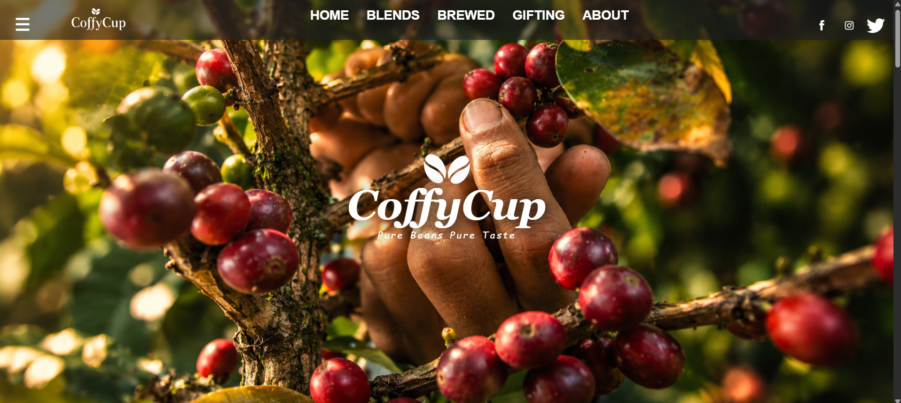
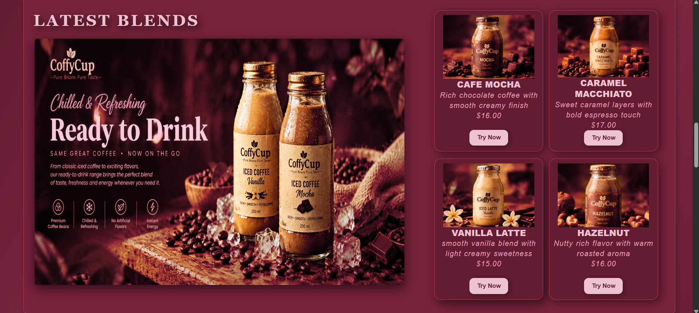
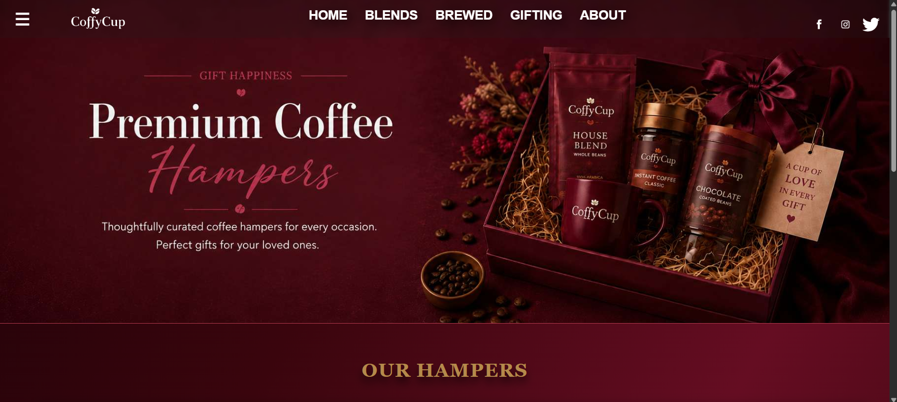
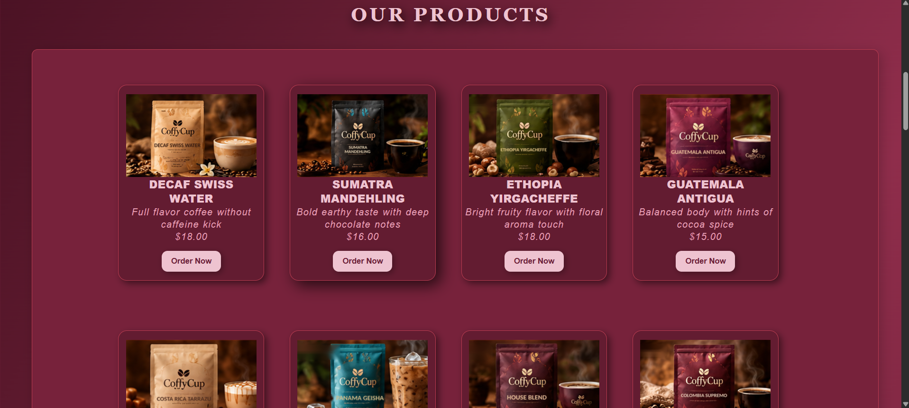
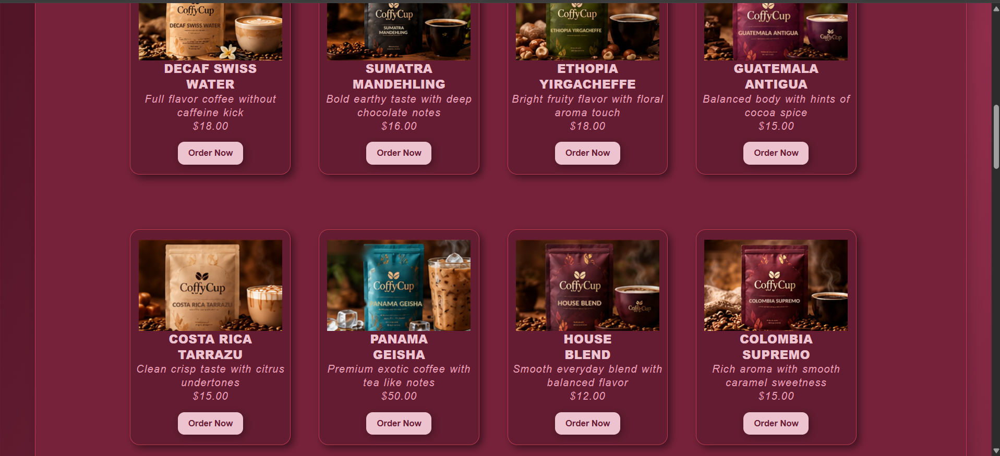
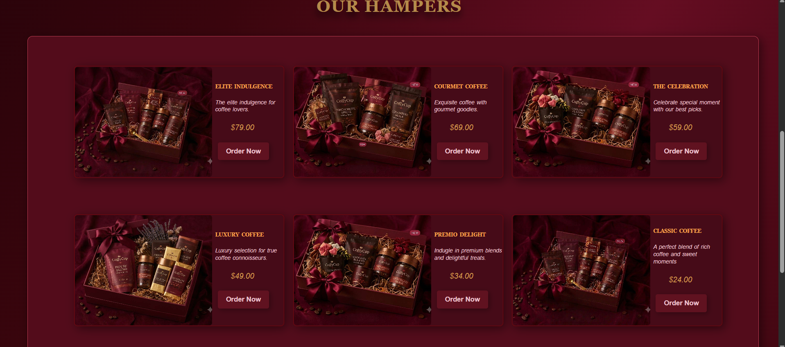
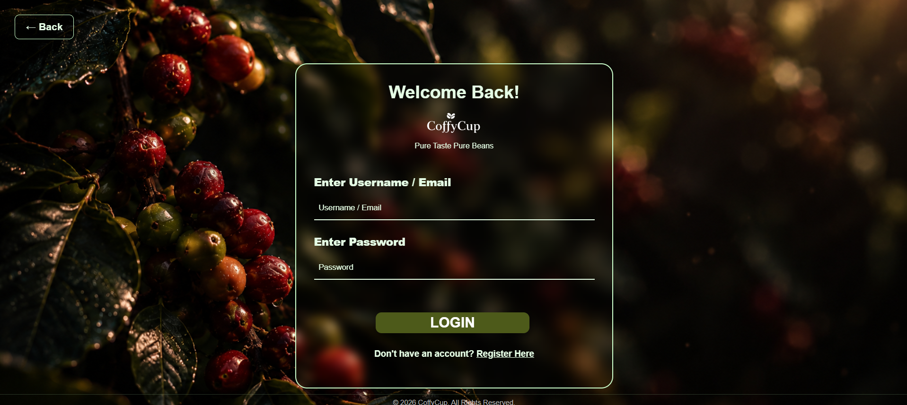
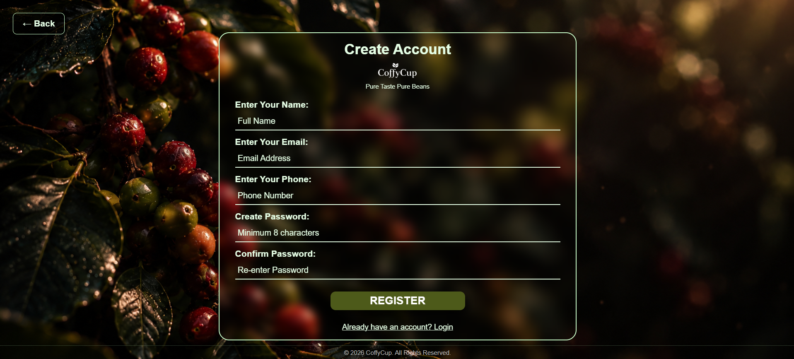
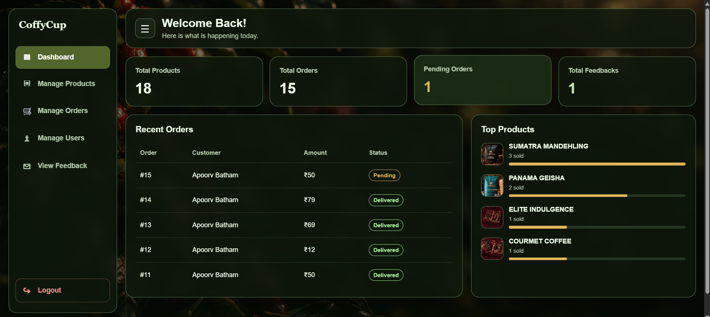

# CoffyCup – A Premium Coffee Brand Website

**Live Website:** https://coffee-website-gbss.onrender.com

CoffyCup is a college mini project developed as part of my Semester 5 BCA coursework. It was my first practical web development project, created mainly to improve my practical knowledge and gain hands-on experience in building a website.

The website presents coffee blends, ready-to-drink beverages, and gifting hampers through an attractive and user-friendly interface. Rather than being an advanced commercial platform, this project focuses on learning and applying the fundamentals of web development, backend programming, and database integration.

## Features

- Coffee-themed homepage with premium design
- Coffee blends and ready-to-drink product sections
- Gifting hampers section
- User registration and login
- Product browsing and ordering functionality
- Cash on Delivery option
- My Orders section
- User feedback functionality
- Admin panel for managing website data
- MySQL database integration

## Website Screenshots

### Homepage

### Coffee Blends

### Product Pages

### Gifting Hampers

### User Authentication

### Admin Panel

## Technologies Used

| Category | Technology |
|---|---|
| Frontend | HTML, CSS, JavaScript |
| Backend | Python, Flask |
| Database | MySQL |
| Template Engine | Jinja2 |
| Local Development | XAMPP |
| Deployment | Render |
| Cloud Database | TiDB Cloud |
| Version Control | Git and GitHub |
| Code Editor | Notepad++ |

## Live Deployment

The CoffyCup website is deployed using Render, with TiDB Cloud as its cloud database.

- **Live Website:** https://coffee-website-gbss.onrender.com
- **Hosting Platform:** Render
- **Database Platform:** TiDB Cloud
- **Source Code:** https://github.com/apoorvbatham27/coffee-website

*Note: The free hosting service may go to sleep after a period of inactivity. The first visit after inactivity may take some time to load.*

## Project Structure

- `app.py` – Main Flask application
- `wsgi.py` – Application entry point for deployment
- `templates/` – HTML templates
- `images/` – Website images and product assets
- `admin/` – Admin-related project files
- `certs/` – SSL certificate used for secure database connectivity
- `requirements.txt` – Python dependencies
- `Procfile` – Deployment start command

## User and Admin Modules

**User Module**
- User registration and login
- Browse available coffee products
- Place orders using Cash on Delivery
- View previous orders
- Submit feedback

**Admin Module**
- Admin authentication
- Manage products
- Manage orders
- View and manage customer feedback

## Learning Objectives

The main objective of this project was to improve my practical programming skills and understand how different web technologies work together. Through this project, I aimed to gain hands-on experience in frontend development, backend programming, and database integration.

I also focused on creating a simple, user-friendly interface with an attractive coffee-themed design, ensuring easy navigation, a clear layout, and a pleasant visual experience that makes users feel comfortable and engaged.

## Future Scope

The CoffyCup website can be enhanced in the future by adding the following features:

1. **Online Payment:** UPI, debit card, and credit card payment options.
2. **Order Tracking:** Allow customers to check their order status.
3. **Product Reviews and Ratings:** Enable users to rate and review coffee products.
4. **Email Notifications:** Send order confirmations and status updates through email.
5. **Improved Search and Filters:** Search products by price, category, and type.
6. **Mobile-Friendly Design:** Improve usability on mobile phones and tablets.
7. **Advanced Admin Dashboard:** Display sales summaries and order statistics.
8. **Wishlist:** Allow users to save their favourite coffee products.

---

**Project:** CoffyCup  
**Project Type:** BCA Semester 5 Mini Project  
**Academic Year:** 2026–27